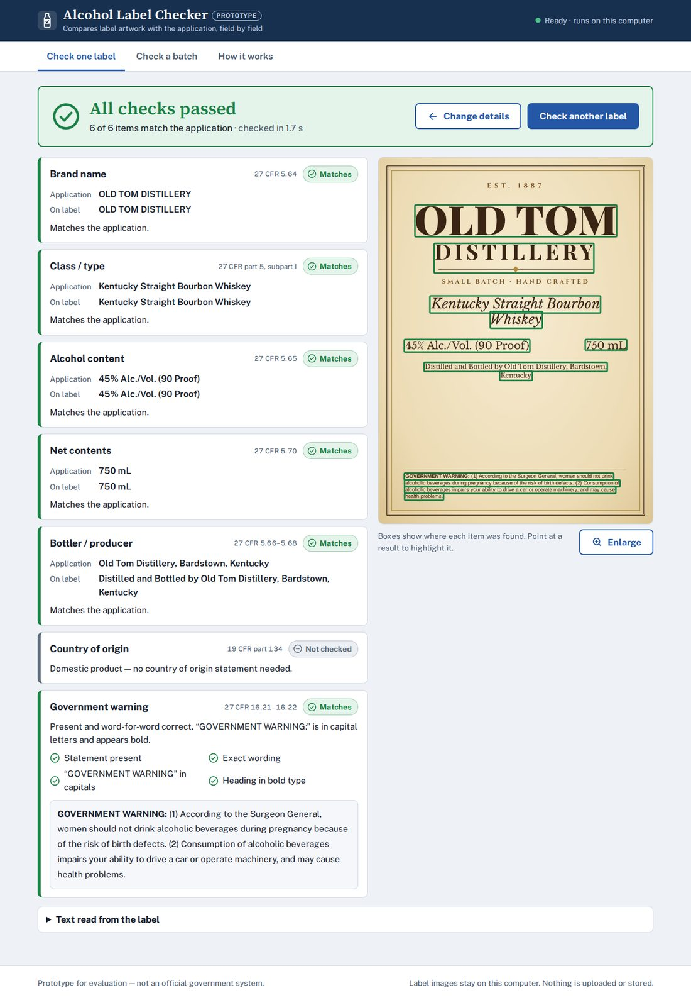
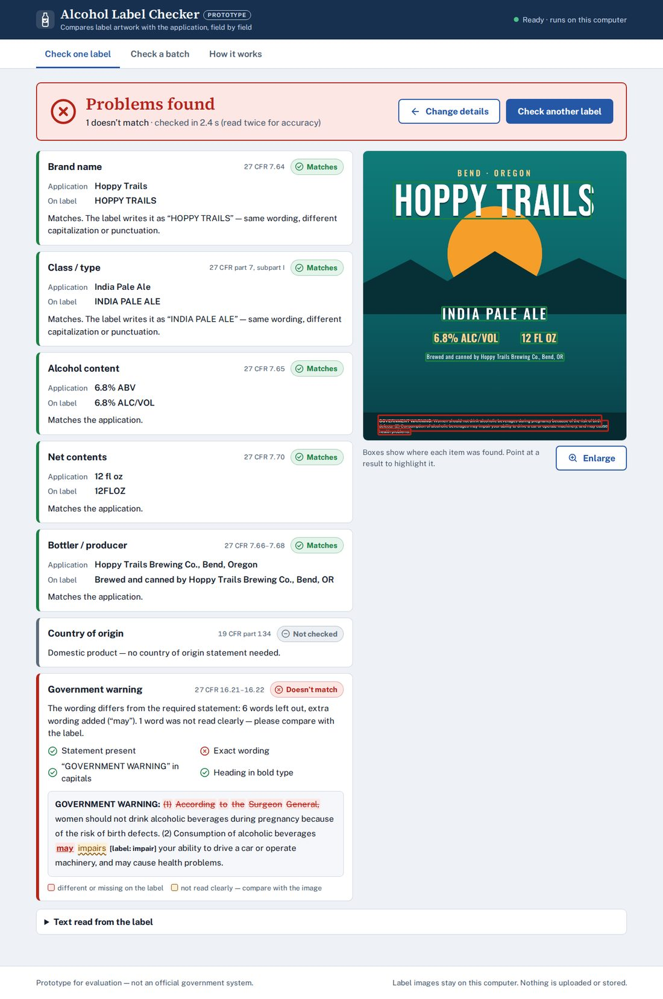
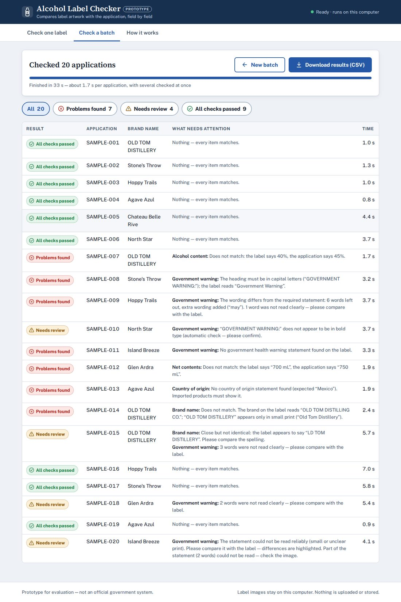

# Alcohol Label Checker

A prototype that checks an alcohol beverage label image against the data in its application: brand name, class/type, alcohol content, net contents, bottler, country of origin and the government health warning. It runs entirely in the web browser. Label images are never uploaded, no API keys are needed, and it works on networks that block cloud AI services.

**Live demo:** https://YOUR-GITHUB-USERNAME.github.io/alcohol-label-verifier/ *(set up in minutes, see [Deploy](#deploy))*

| One label | Warning check | Batch |
| --- | --- | --- |
|  |  |  |

---

## Contents

- [Try it](#try-it)
- [Run locally](#run-locally)
- [Deploy](#deploy)
- [How it works](#how-it-works)
- [Why it is built this way](#why-it-is-built-this-way)
- [Results](#results)
- [Assumptions](#assumptions)
- [Limitations and next steps](#limitations-and-next-steps)
- [Project layout](#project-layout)
- [Third-party software](#third-party-software)

## Try it

The app opens with a built-in example already filled in. Press **Check label** to see a result. Then pick another one from **Try a built-in example**. There are 20 examples:

- **Correct labels:** bourbon, gin, IPA, imported tequila, imported wine (front and back images), vodka.
- **Labels with a problem:** wrong ABV, “Government Warning” in title case, altered warning wording, heading not bold, missing warning, wrong net contents, missing country of origin, different brand name.
- **Hard-to-read photos:** curved bottle, 25° angle with dim light, heavy glare, blur and noise, a photo rotated sideways, and a 520-pixel image.

To see the batch mode, open **Check a batch** and press **Load the sample batch**. It checks the 20 examples at once.

Each check gives one of these results:

| Status | Meaning |
| --- | --- |
| **Matches** | The label agrees with the application. Case and punctuation differences (STONE’S THROW vs Stone’s Throw) still count as a match, and the app points them out. |
| **Please check** | Nearly the same, or hard to read. The app shows what it read so the agent can decide quickly. |
| **Doesn’t match** | The label clearly says something else (40% instead of 45%). |
| **Not found** | Required text is not on the label. |
| **Not checked** | Nothing to compare, for example country of origin on a U.S. product. |

The overall verdict is **All checks passed**, **Needs review** or **Problems found**. The tool never passes a label it could not read. When it is unsure, it asks a person to look.

## Run locally

Requirements: Node.js 20.19 or newer.

```bash
npm ci
npm run dev          # http://localhost:5173
```

| Command | What it does |
| --- | --- |
| `npm test` | Unit tests for parsing, matching and every check (Vitest, about 1 s). |
| `npm run eval` | Reads the 20 example labels with the real OCR engines under Node and compares the results with the answer key. |
| `npm run eval -- --holdout` | The same for 12 held-out labels in designs the thresholds were never tuned on. |
| `npm run build` | Type-check and production build into `dist/`. |
| `npm run test:e2e` | Opens the built app in Chromium, runs every example and the sample batch through the UI, and checks the results. Run `npx playwright install chromium` once first. |
| `npm run samples` | Re-renders the example labels (`-- --holdout` for the held-out set). |

## Deploy

`dist/` is a static site: no server, no database, no secrets. It works from any static host.

**GitHub Pages** (the workflow is included):

1. Create an empty GitHub repository named `alcohol-label-verifier`, then push this project to it:
   ```bash
   git remote add origin https://github.com/YOUR-GITHUB-USERNAME/alcohol-label-verifier.git
   git push -u origin main
   ```
2. In the repository open **Settings → Pages**. Under **Build and deployment**, set **Source** to **GitHub Actions**.
3. The **Test and deploy** workflow (`.github/workflows/deploy.yml`) runs the unit tests, builds, and publishes. The site appears at `https://YOUR-GITHUB-USERNAME.github.io/alcohol-label-verifier/`. If the first run finished before Pages was enabled, open **Actions** and use **Re-run all jobs**.

The same workflow also runs the accuracy evaluation and the browser end-to-end test in a separate job, so they never block a deployment.

**Anywhere else:** run `npm run build` and upload `dist/` (Azure Static Web Apps, Netlify, Vercel, S3, an internal web server). Asset paths are relative, so any sub-path works.

## How it works

```mermaid
flowchart LR
  A[Label image(s)] --> B[Decode in browser<br/>EXIF rotation, resize]
  B --> C[First reading<br/>Tesseract.js ~1 s]
  C --> D{Compare with<br/>application}
  D -- everything matches --> R[Result]
  D -- anything unclear --> E[Second look<br/>PaddleOCR neural nets]
  E --> F{Compare again,<br/>best evidence wins}
  F --> R
  B -. on multi-core machines .-> E
```

1. **Read.** Tesseract.js reads the label, which takes about a second for typical label artwork. Most clean labels are fully verified here.
2. **Compare.** The app does not try to work out which text is the brand name. It already knows what to look for from the application, so it searches the label text for each expected value (see [Verification, not extraction](#verification-not-extraction)).
3. **Second look.** If any field is not a clear match, a second OCR engine reads the label. PaddleOCR detects text with a neural network (DB) and recognises it with an SVTR model running on ONNX Runtime Web. It copes with curved bottles, perspective, glare, dark labels and decorative fonts. Lines that Tesseract already verified are reused rather than read again, so the second look only spends time on the unclear parts. On machines with 4 or more cores, its text detection starts at the same time as the first reading.
4. **Result.** Each field gets a status, the text actually read, a plain-language explanation and a box on the image showing where it was found. If the agent edits a field and checks again, only the comparison re-runs, which is instant.

### The checks

| Field | Rule applied | Regulation |
| --- | --- | --- |
| Brand name | Must appear in the prominent (large) text. Case, punctuation and spacing are ignored, and the app says when they differ. If the name appears only in small print (for example in “Bottled by Old Tom Distillery”) while the large text says something else, that is a mismatch. | 27 CFR 5.64 / 4.33 / 7.64 |
| Class / type | Fuzzy match. “Whisky” and “whiskey” are treated as equivalent. | 27 CFR 5 subpart I / 4.34 / 7 subpart I |
| Alcohol content | Compared as a number (45 = 45% Alc./Vol.). Warns if the proof is not 2 × ABV, or if the percentage is not described as alcohol by volume. Optional for beer, and for wine when the application leaves it blank. | 27 CFR 5.65 / 4.36 / 7.65 |
| Net contents | Compared as a volume across units (750 mL = 0.75 L, 12 fl oz = 355 mL, 16 fl oz = 1 pint). Wine and spirits must show metric units. Beer must show U.S. units. | 27 CFR 5.70 / 4.37 / 7.70 |
| Bottler / producer | The name, then each address part, which must appear next to the name. State names match postal codes (Oregon = OR). | 27 CFR 5.66–5.68 / 4.35 / 7.66–7.68 |
| Country of origin | Required when the application names a foreign country. | 19 CFR part 134 |
| Government warning | Word-for-word against the statutory text. “GOVERNMENT WARNING:” must be in capital letters and bold. | 27 CFR 16.21–16.22 |

#### The government warning, in detail

- **Wording.** The official statement is aligned character by character against what was read. Each word is marked as correct, not read clearly, changed, left out or unreadable, and extra words are detected. The result screen shows the statement with the differences highlighted.
- **Label error or OCR error?** The app tells the two apart. Words left out mid-line and confidently read extra words (“may impair”) mean the label is wrong, so the result is **Doesn’t match**. One- or two-letter slips (“defecls”) and garbled small print mean a person should look, so the result is **Please check**. If the reading is poor overall, the app never reports a wording mismatch.
- **Capitals.** The heading is checked letter by letter. Letters whose capital and small forms look alike (C, O, S, V, W, X, Z) are ignored, because OCR cannot tell their case apart.
- **Bold.** OCR engines do not report font weight, so the app measures stroke thickness from the pixels. The estimate is 2 × ink area ÷ outline length, using grey levels for sub-pixel precision. The heading must be at least 1.2× thicker than the words next to it. On the samples, bold headings measure 1.3–2.7× and a regular-weight heading measures 0.99×.

### Verification, not extraction

A general OCR system has to decide which text is the brand name and which is the class. This app does not, because the application already says what the label should contain. It looks for those exact values with approximate matching, where swaps OCR commonly makes (0/O, 1/l, 5/S) cost half. This is much more robust than extracting fields blindly. It also allows a precise explanation of every difference: “the label says 40%, the application says 45%”.

## Why it is built this way

Each major decision traces back to something the stakeholders said.

| Stakeholder concern | Decision |
| --- | --- |
| **Marcus:** the firewall blocks outbound traffic, and the vendor’s cloud ML endpoints failed | All OCR runs **locally in the browser** (WebAssembly). The app downloads only its own static files, which can be hosted inside the agency. It makes no calls to AI services and needs no API keys. |
| **Marcus:** PII and document retention | Images stay in the browser tab. Nothing is uploaded, stored or logged. |
| **Sarah:** results in about 5 seconds, or nobody will use it | A fast first pass (about 1 s), with the slower engine only when needed. The second look reuses verified text and starts detection early on multi-core machines. Measured times are in [Results](#results). |
| **Sarah:** batches of 200–300 labels | **Batch mode**: images plus a CSV with one row per application, processed in parallel, filterable results, CSV export. |
| **Sarah:** “something my mother could figure out” | Two numbered steps and one big button. 18 px type, high contrast, and plain words (“Doesn’t match”, not “FAIL”). Status is always shown by icon and word, never by colour alone. Keyboard and screen-reader friendly. The app opens with a filled-in example. |
| **Dave:** STONE’S THROW vs Stone’s Throw needs judgment | Case and punctuation differences are a match with a note. Near-misses become **Please check**, not failures. The person stays in charge. |
| **Jenny:** the warning must be exact, capitals and bold | A dedicated warning check with a word-level diff, a capitals check and a bold measurement. |
| **Jenny:** photos at angles, with glare or bad light | The second-look engine, orientation detection (sideways and upside down), tilt-aware reading order, and handling of small images. |

**Why not a cloud AI vision model?** It would read stylised labels well. But it breaks the firewall constraint and sends potentially sensitive submissions to an outside service. It also needs API keys and a paid account, adds network latency to the 5-second budget, and gives answers that are harder to audit. The design leaves room for one: in production, items still marked **Please check** could be escalated to a model hosted inside the agency’s Azure Government (FedRAMP) boundary. Everything else would stay local.

**Why two OCR engines?** They were benchmarked on the 21 sample images before building. “Fields found” counts printed fields (brand, class, ABV and so on) that each engine read, out of 105. “Warning text similarity” is how closely the warning it read matched the official text:

| Engine | Fields found | Warning text similarity | Notes |
| --- | --- | --- | --- |
| Tesseract | 94 / 105 | 98.5% | Fast, excellent on flat artwork and small print. Misses text on curved, glary or dark photos. |
| PaddleOCR | 102 / 105 | 97.0% | Robust on photos and display fonts. Slower, and sometimes drops spaces or confuses w/W. |
| Both combined | 104 / 105 | 99.4% | Chosen design: Tesseract first, PaddleOCR for the hard parts. |

## Results

**Accuracy.** “Correct” means the right overall verdict and the right status for every field the answer key asserts. Every deliberate error is caught, and no incorrect label passes.

| Set | Correct | Notes |
| --- | --- | --- |
| 20 built-in examples | **20 / 20** | In the browser (`npm run test:e2e`) and under Node (`npm run eval`). |
| 12 held-out labels | **12 / 12** | New designs: dark label with an all-capitals warning, a warning printed sideways, a two-column layout, a pint-vs-fl-oz comparison and a wrong country. The first run scored 11/12. The miss was a status nuance (“Not found” instead of “Doesn’t match”, with the verdict already correct), which led to one general fix. |

**Speed.** Measured in headless Chromium on a small **2-vCPU cloud VM**. A typical office desktop is faster.

| | Time |
| --- | --- |
| Clean label artwork (first pass only) | 0.8–2.0 s |
| Per label, all 20 examples | median 2.4 s, mean 2.6 s, max 5.4 s (curved-bottle photo) |
| The same, host sends cross-origin isolation headers | median 1.9 s, mean 2.1 s, max 3.4 s |
| Batch of 20 applications | 33 s end to end, about 1.7 s per application (28 s with isolation headers) |
| First visit | About 31 MB of engines and models (Tesseract 7 MB, PaddleOCR 10 MB, ONNX Runtime 14 MB), cached by the browser afterwards. Checking can start once the 7 MB Tesseract files have loaded; the second engine keeps loading in the background. |

## Assumptions

- There is no COLA integration (per Marcus). The agent types or pastes the application values, or supplies a CSV for batches.
- Labels are English-language labels for the U.S. market.
- The application value for **bottler** is the name, then the address, separated by commas, for example “Old Tom Distillery, Bardstown, Kentucky”.
- A blank **country of origin** means a domestic product. A blank **alcohol content** is accepted for beer and wine, and flagged for spirits.
- Alcohol content must equal the application exactly. Legal tolerances (±0.3%, etc.) are about lab analysis versus the label, not the label versus the application.
- For the warning, the wording must be exact but the case of the body text is not enforced, because statements printed entirely in capitals are common. The heading must be in capitals and bold.
- Several images per application (front and back labels) are combined, and a field may be found on any of them.

## Limitations and next steps

- **Physical type size** (1–3 mm minimum for the warning, characters per inch) cannot be measured from a photo without a known scale.
- **Other labeling rules** are not checked: sulfite, FD&C Yellow No. 5 and other disclosures, age statements, standards of fill, and “same field of vision” placement.
- **Very stylised script, heavy glare or strong curvature** may produce **Please check** instead of an automatic decision. This is by design, but it costs the agent a glance.
- **Speed depends on the agent’s computer.** On GitHub Pages, ONNX Runtime runs single-threaded, because Pages cannot send the cross-origin isolation headers that WebAssembly threads need. Hosts that can send them pick up threads with no code change: `public/staticwebapp.config.json` (Azure Static Web Apps) and `public/_headers` (Netlify, Cloudflare Pages) are included. On the same 2-vCPU machine, this cut the slowest check from 5.4 s to 3.4 s.
- **Evaluation data is synthetic.** The labels were rendered from HTML/CSS with simulated photo effects, and the held-out set checks generalisation to new designs. The next step would be real COLA label images with agent decisions, used to tune the thresholds.
- **Production path:** host inside the agency’s Azure tenant, read application data from COLA, record the agent’s decision next to the tool’s result for audit and threshold tuning, do a full Section 508 audit, and optionally escalate to an Azure Government vision model (see above).

## Project layout

```
src/
  domain/              Verification logic: pure TypeScript, no browser APIs, unit-tested
    verify.ts            application + OCR readings -> field results + verdict
    checks.ts            brand, class/type, alcohol, net contents, bottler, country
    warning.ts           government warning: wording diff, capitals, bold
    fuzzy.ts             approximate search and alignment with OCR-aware costs
    units.ts             ABV / proof / volume parsing and unit conversion
    stream.ts, search.ts flatten OCR text for searching, trace matches back to boxes
  core/checkLabel.ts   first reading -> compare -> second look -> compare
  ocr/
    paddle/              PaddleOCR in TypeScript: DB post-processing, rotated crops,
                         CTC decoding, orientation, reading order
    tesseract/           Tesseract.js output adapter
    strokes.ts           stroke-width measurement for bold detection
    browser/             Web Worker, engine loading (self-hosted), image decoding
  batch/manifest.ts    CSV manifest parsing, template, results export
  ui/                  React components
tools/sample-labels/   renders the example and held-out labels (HTML/CSS + photo effects)
tools/eval/            command-line accuracy evaluation (same engines as the browser)
tests/unit/            Vitest unit tests
tests/e2e/             Playwright end-to-end test of the built app
public/models/         PaddleOCR ONNX models (see its README for provenance)
public/samples/        example labels, answer key, sample batch CSV
test-data/holdout/     held-out evaluation labels
```

**Stack:** TypeScript, React 19, Vite. OCR by Tesseract.js 7 and PaddleOCR (PP-OCRv3 detection, PP-OCRv4 recognition) on ONNX Runtime Web 1.30. Tests use Vitest and Playwright.

## Third-party software

| Component | License |
| --- | --- |
| [Tesseract.js](https://github.com/naptha/tesseract.js), Tesseract English LSTM model | Apache-2.0 |
| [PaddleOCR](https://github.com/PaddlePaddle/PaddleOCR) models, ONNX conversion by [RapidOCR](https://github.com/RapidAI/RapidOCR) | Apache-2.0 |
| [ONNX Runtime Web](https://github.com/microsoft/onnxruntime) | MIT |
| React, Papa Parse | MIT |
| Public Sans, Source Serif 4 (UI); Google Fonts families used only to render the sample labels | SIL Open Font License |

This is a prototype for evaluation. It is not an official government system and is not affiliated with TTB.
